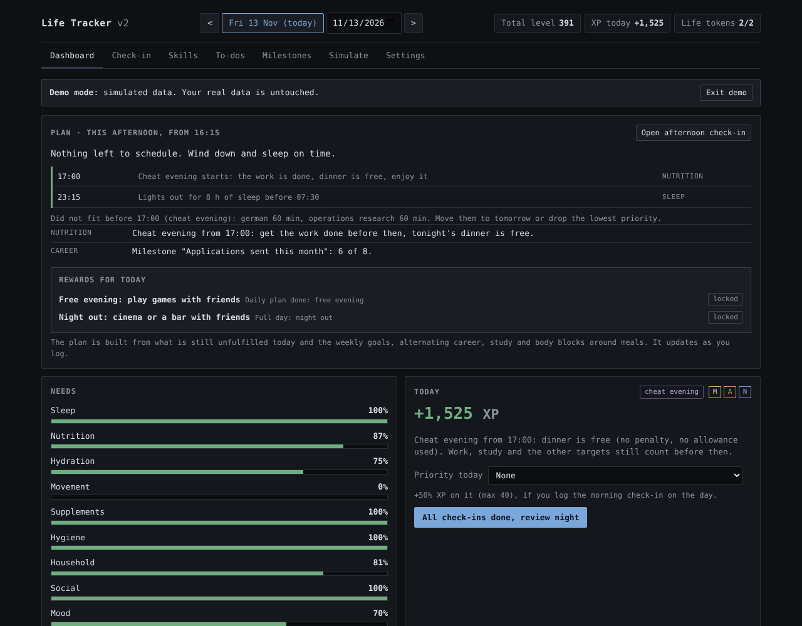
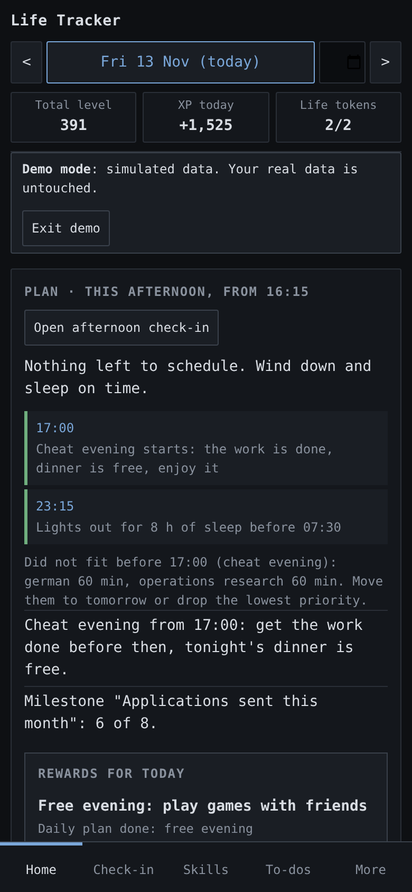
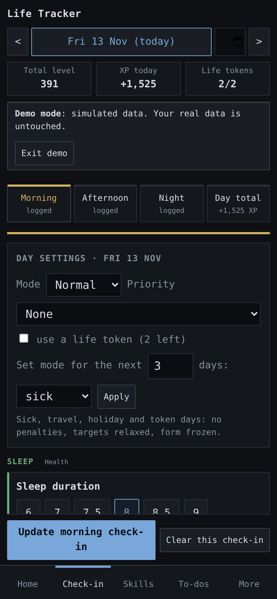
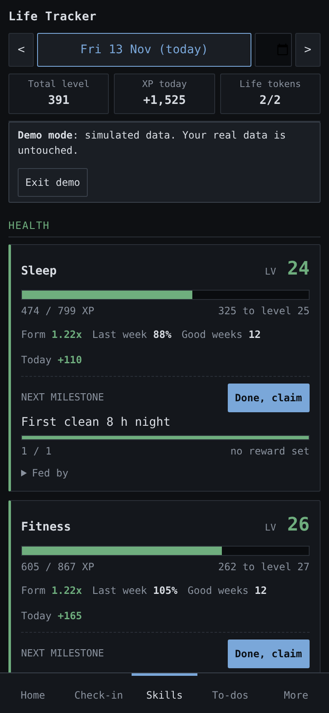
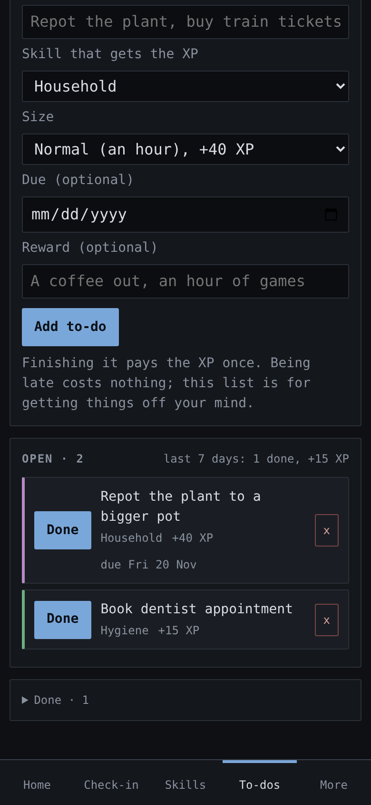

# Life Tracker

A gamified tracker for everyday life. Needs bars (sleep, nutrition, household, social...), skill XP and levels, quests with real-world rewards, a to-do list with a momentum boost, and a daily plan that schedules the day around what is still open. It is a single-page app that works offline, installs on a phone like an app and can sync across devices.



<p>
  
  
  
  
</p>

All screenshots use simulated demo data.

## What it does

- **Three check-ins a day** (morning, afternoon, night). Study, hydration, exercise and similar items can be entered in any slot and are added up in a Day total tab.
- **Skills and levels**: each habit feeds a skill. XP follows a level curve, with a form multiplier (0.7x to 1.3x from recent performance), a cap on losses, a weekly consistency bonus and reduced credit for backfilled days.
- **Household bar**: rooms decay at their own pace (kitchen 3 days, bathroom 2 weeks...). The roll-up is a weighted harmonic mean, so one neglected heavy room drags the total down.
- **Quests** with composite conditions (several habits on the same day, streaks, levels, "all of these quests") and rewards you define.
- **To-dos** that pay XP once; each finished to-do on a day adds a Momentum boost (+10%, +18%, +25% cap) to that day's habit XP.
- **Daily plan**: a transparent scheduler that interleaves career, study and body blocks around meal anchors, stops before bedtime (or a weekly cheat evening) and lists what did not fit.
- **Sync** across devices through a Supabase row per user, merged per day (newer edit wins), with offline queueing.
- **Installable PWA**, share-sheet backup to any app (for example Google Drive).

## How it is built

| Part | Notes |
|---|---|
| `src/engine.js` | Pure scoring engine, no DOM. State is an event log (`logs[date]`); `compute(state)` replays it and derives all XP, levels, bars and the plan. Deterministic, so it is easy to test and to sync. |
| `src/sync_core.js` | Pure merge logic: per-section and per-day last-write-wins using change stamps; richer data wins ties. |
| `src/app_*.js`, `style.css` | Vanilla JS UI (no framework), flat monospace design, mobile-first at 640px and below. |
| `src/build.js` | Inlines everything into one HTML file and writes the installable site to `docs/` (manifest, service worker, icons). |
| `supabase/schema.sql` | One table, row-level security so a user can only read and write their own row. |
| `tests/` | Scoring tests, merge tests and a multi-persona long-run simulation used to tune the level curve. |

Design choices worth noting:

- Scoring is a pure function of the log, so changing a rule recomputes history and nothing needs a migration of derived values.
- Penalties are deliberately smaller than rewards, and an unanswered check-in counts as a small assumed miss instead of a blank.
- The configuration (targets, rooms, quests) lives in the user's data, not in the code. Older stored configs are upgraded by a versioned `upgradeConfig`.

## Run it

```
npm test          # scoring and sync tests
npm run sim       # 90-day simulation for several personas
npm run build     # writes docs/ (served by GitHub Pages) and dist/life-tracker.html
```

No dependencies are needed to build or test; only Node 18 or newer.

To host your own copy with sync and install it on a phone, follow [SETUP.md](SETUP.md).

## Privacy

The code is public, your data is not. Data stays in your browser, and with sync on, in your own Supabase project behind a login. The Supabase URL and anon key are public by design; row-level security protects the data.

## License

MIT
